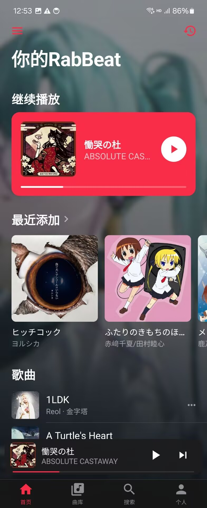
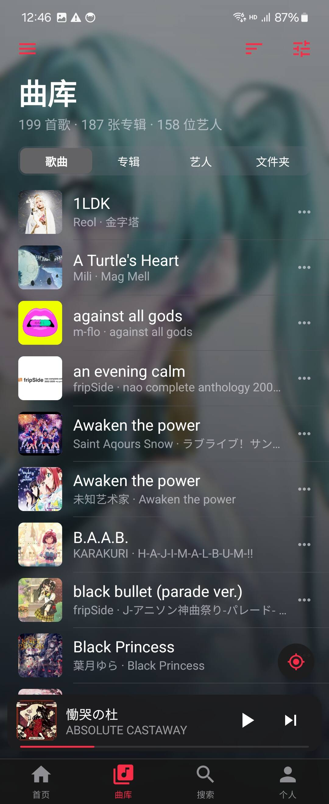
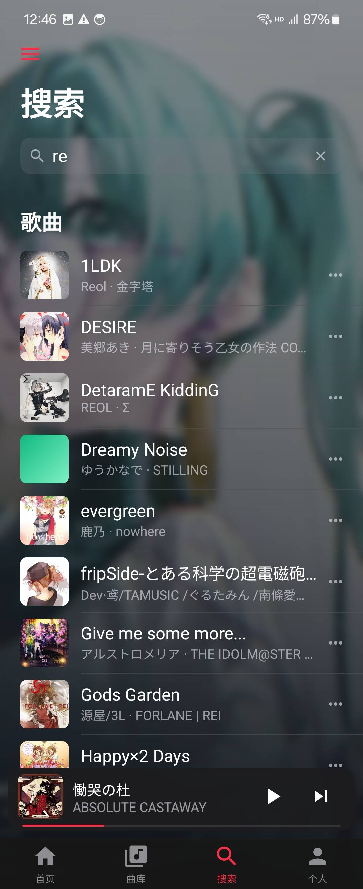
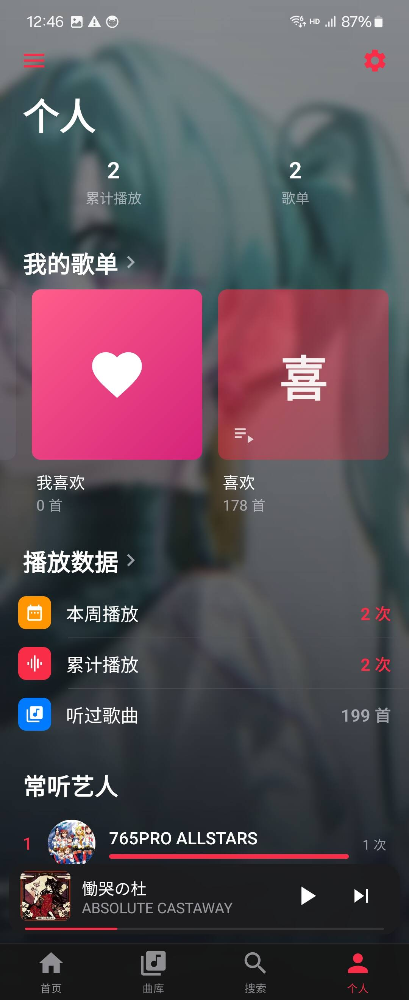
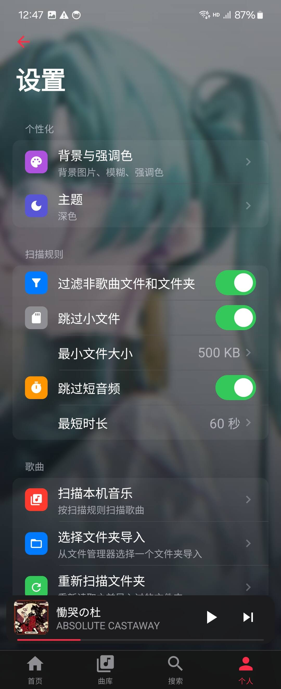
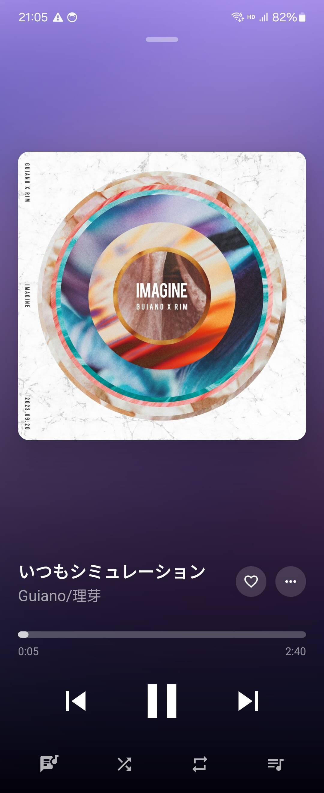
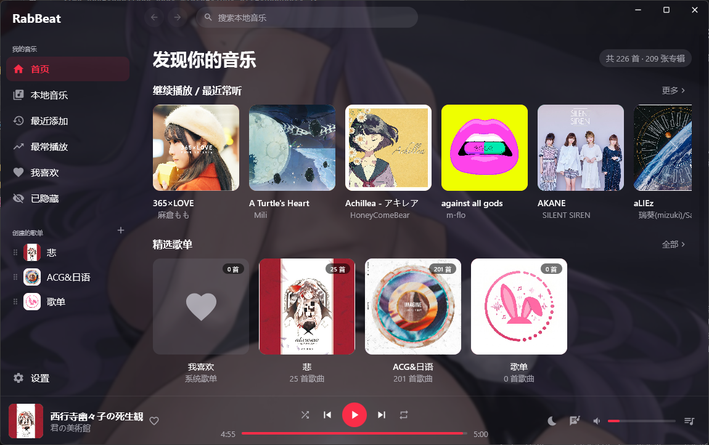
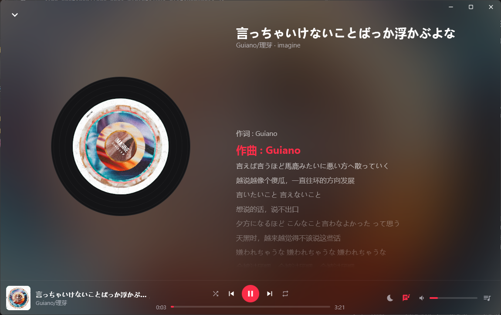

<p align="center">
  
</p>
<h1 align="center">RabBeat</h1>

<p align="center">离线优先的个人音乐播放器。Android 手机版，以及 Windows 桌面版。</p>

包名 `com.rabbeat.app`。手机支持 Android 8.0（API 26）及以上。

## 下载

在 [Releases](https://github.com/reisen7/RabBeat/releases) 下载最新版本

## 效果图

<p>
  
  
  
  
  
  
</p>

## 功能

- **本地曲库**：扫描本机和文件夹，匹配 `.lrc` 歌词；网易云 `.ncm` 加密文件解密入库；自动去重；歌曲可隐藏不删文件。
- **播放**：后台播放、通知栏控制、睡眠定时、倍速；歌词逐行滚动，可借用其他歌的歌词。
- **歌单**：「我喜欢」+ 自建歌单，拖动排序、多选批量操作、从文件夹导入；封面用列表里第一首有封面的歌，也可以自己裁一张。
- **网易云导入**：粘贴链接或歌单 ID 导入，在线播放并缓存，自动带歌词。
- **个性化**：背景图裁剪、模糊、压暗、卡片透明度；五种强调色、深浅主题。
- **其他**：曲库备份恢复、播放历史与统计。

## 桌面端

Windows 上是同一套曲库。左侧导航和歌单，底部播放条，点进去是唱片和歌词。

<p>
  
  <br />
  
</p>

- **曲库**：导入本地文件夹，扫描歌曲并匹配歌词。`.ncm`、`.qmc` 会解密后再入库。也可以导入网易云歌单，在线播放并缓存。
- **歌单**：我喜欢和自建歌单。没有自己设封面时，用列表里第一首有封面的歌。往歌单里加歌会放到最前面，并出现一条自动消失的提示。
- **播放**：底部播放条控制播放、切歌、音量和播放列表。播放页是唱片封面加滚动歌词。
- **外观**：浅色、深色或跟随系统，五种强调色。可以换背景图，并调模糊、压暗和卡片透明度。
- **窗口**：点关闭可以收进系统托盘，音乐继续放。缓存目录、解密后的歌曲目录都可以改。
- **和手机同步**：电脑和手机连同一个 Wi-Fi。电脑在设置里打开「和手机同步歌单」，手机在设置里选「和电脑同步」，扫电脑上的二维码。歌单、喜欢，以及一边缺的歌曲、封面和歌词会对齐。同步时留在电脑这个页面，并在 Windows 防火墙里允许本程序。

## 开发环境

- JDK 17
- Android SDK：`compileSdk` 37.2，`targetSdk` 35，`minSdk` 26
- Gradle 9.9.0，Android Gradle Plugin 9.2.1

### 构建

用 Android Studio 打开本目录，或在项目根目录执行：

```bat
gradlew.bat :app:assembleDebug
gradlew.bat :app:testDebugUnitTest
gradlew.bat :desktopApp:packageWindows "-PversionName=0.1.0"
```

## 许可证

本项目基于 [MIT License](LICENSE) 开源。
