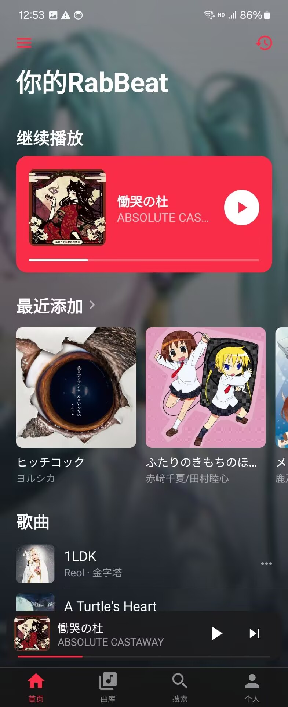
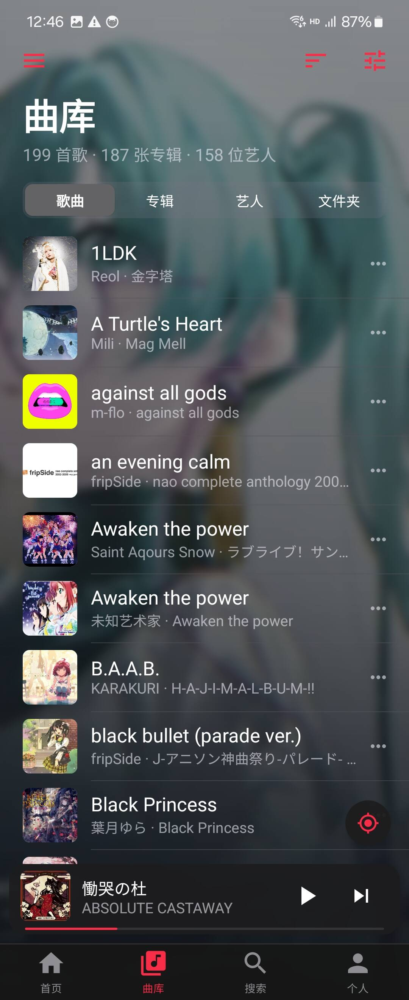
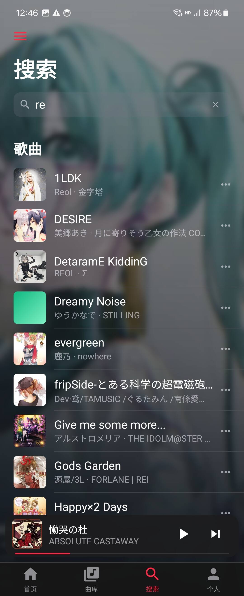
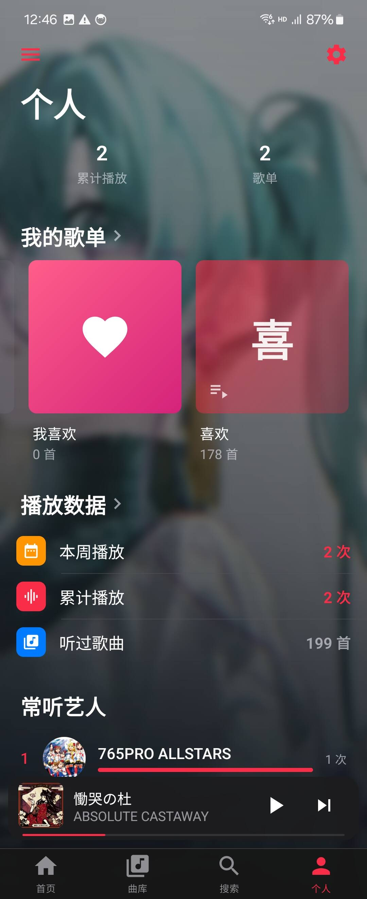
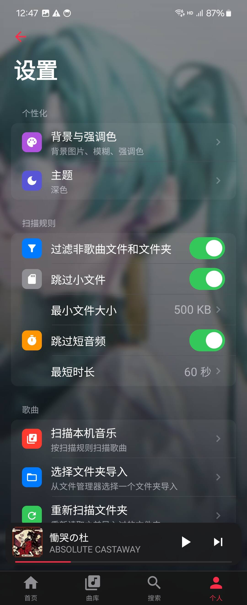
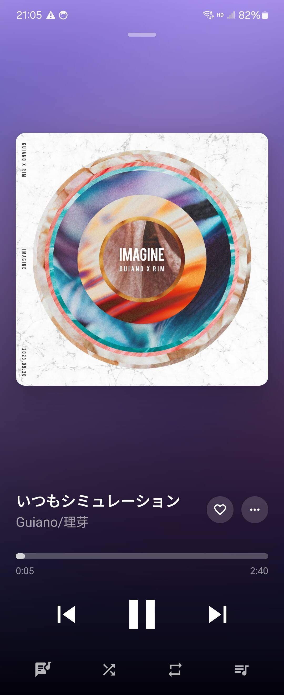

<p align="center">
  
</p>
<h1 align="center">RabBeat</h1>

<p align="center">离线优先的 Android 本地音乐播放器，Apple Music 风格界面。</p>

包名 `com.rabbeat.app`，支持 Android 8.0（API 26）及以上。

## 下载

在 [Releases](https://github.com/reisen7/RabBeat/releases) 下载最新的 `RabBeat-<版本>.apk` 直接安装。

## 截图

<p>
  
  
  
  
  
  
</p>

## 功能

- **本地曲库**：扫描本机和文件夹，匹配 `.lrc` 歌词；网易云 `.ncm` 加密文件解密入库；自动去重；歌曲可隐藏不删文件。
- **播放**：后台播放、通知栏控制、睡眠定时、倍速；歌词逐行滚动，可借用其他歌的歌词。
- **歌单**：「我喜欢」+ 自建歌单，拖动排序、多选批量操作、从文件夹导入；封面取最新歌曲封面或自定义裁剪。
- **网易云导入**：粘贴链接或歌单 ID 导入，在线播放并缓存，自动带歌词。
- **个性化**：背景图裁剪、模糊、压暗、卡片透明度；五种强调色、深浅主题。
- **其他**：曲库备份恢复、播放历史与统计。

## 开发环境

- JDK 17
- Android SDK：`compileSdk` 37.2，`targetSdk` 35，`minSdk` 26
- Gradle 9.9.0，Android Gradle Plugin 9.2.1

### 构建

用 Android Studio 打开本目录，或在项目根目录执行：

```bat
gradlew.bat :app:assembleDebug
gradlew.bat :app:testDebugUnitTest
```

## 许可证

本项目基于 [MIT License](LICENSE) 开源。
